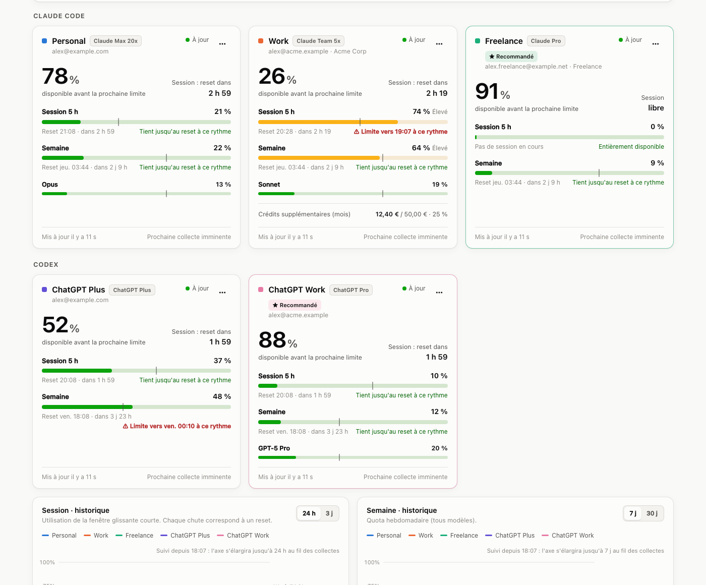
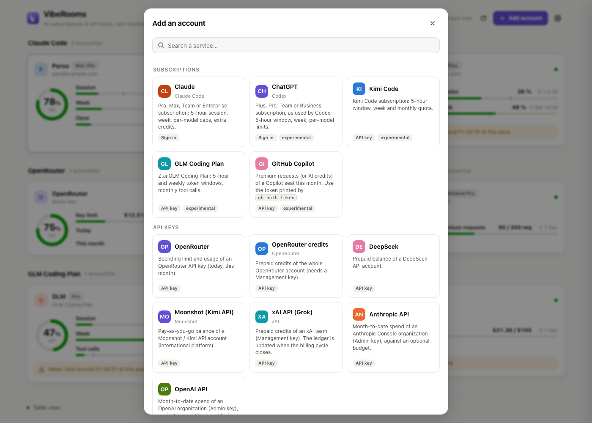

# VibeRooms

**Combien de marge te reste-t-il sur tes abonnements IA ?** VibeRooms est un petit service auto-hébergé qui suit les
quotas de tes abonnements et clés API d'IA (Claude, ChatGPT, GitHub Copilot, OpenRouter, DeepSeek, API OpenAI et
Anthropic…), avec plusieurs comptes par service. Tout autre service qui expose ses quotas en HTTP s'ajoute depuis le
tableau de bord, sans code. Il affiche la marge restante avant la
prochaine limite et l'heure de son reset. Il indique aussi si tu vas atteindre la limite au rythme actuel, et quel
compte utiliser maintenant.

[English](README.md)



- **Tableau de bord** : pour chaque compte, la marge avant la prochaine limite, la session 5 h, la semaine, les
  limites par modèle, les crédits supplémentaires, un repère de rythme, une projection (« limite vers 19:10 à ce
  rythme ») et l'historique.
- **« À utiliser maintenant »** : pour chaque outil (Claude Code, Codex), le compte qui a le plus de marge.
- **App barre de menus macOS** : une jauge par compte, un menu natif, des notifications à 80 %, 95 % et au reset.
- **Barre d'état de Claude Code** : `Perso 20% ↻1h22 · sem 4% │ Boulot 31% dispo`.
- **Intégration [Homepage](https://gethomepage.dev)** : un groupe de widgets, synchronisé automatiquement.
- **Auto-hébergé** : un seul binaire Rust (≈ 7 Mo) avec SQLite. Lance-le sur ton propre ordinateur (le serveur et l'app
  visent `127.0.0.1:8790` par défaut), ou sur une machine toujours allumée jointe par Tailscale pour le suivre depuis
  tous tes appareils, sans trou dans l'historique quand ton portable dort. Aucun cloud, aucune télémétrie.
- Interface **français / anglais**.

> [!WARNING]
> **Non officiel.** VibeRooms n'est affilié ni à Anthropic, ni à OpenAI, ni à Google. Aucune API publique n'expose
> les quotas des abonnements. VibeRooms se connecte donc avec les clients OAuth des CLI officielles (Claude Code,
> Codex) et lit les endpoints internes qu'elles utilisent. Ils peuvent changer ou casser à tout moment, et leur
> usage n'est peut-être pas couvert par les conditions des fournisseurs. VibeRooms **lit** seulement ton profil et ton
> usage : il n'envoie jamais de requête au modèle. Tu l'utilises à tes risques ; lis d'abord les conditions de tes
> fournisseurs.

## Services pris en charge

| Service | Ce qui est suivi | Connexion | État |
|---|---|---|---|
| Claude (Pro, Max, Team, Enterprise) | session 5 h, semaine, limites par modèle, crédits | OAuth | Stable |
| ChatGPT (Plus, Pro, Team…), via Codex | fenêtre 5 h, semaine, limites par modèle | OAuth | Expérimental |
| GitHub Copilot | requêtes premium ou crédits IA du mois | `gh auth token` | Expérimental |
| Kimi Code, GLM Coding Plan | fenêtres 5 h et hebdo, quotas mensuels | clé du forfait | Expérimental |
| OpenRouter, DeepSeek, Moonshot | crédits, plafond, solde | clé API | API documentée |
| API xAI, Anthropic, OpenAI | crédits prépayés, dépenses du mois face au budget | clé de gestion / admin | API documentée |
| **Tout le reste** | restant / utilisé / plafond / % / reset lus dans n'importe quel JSON | [connecteur personnalisé](README.md#custom-connectors) | — |

Impossible aujourd'hui : **Google AI Pro/Ultra** (basculé vers Antigravity, fermé), **SuperGrok** et **Mistral Le
Chat** (pas d'API). L'**API Gemini (AI Studio)** est prévue via Cloud Monitoring.

## Fonctionnement

Chaque compte se connecte **depuis le tableau de bord**, avec sa propre session OAuth (PKCE) et le scope le plus
restreint possible (`user:profile` pour Claude). VibeRooms **ne réutilise jamais les jetons de tes CLI**. Les refresh
tokens tournent à chaque rafraîchissement : les partager déconnecterait ton Claude Code ou ton Codex. Les jetons
restent sur le serveur, dans `accounts.json` (mode `0600`), et ne sont jamais envoyés au navigateur ni à l'app.

## Installer le serveur

**Binaires prêts à l'emploi** : télécharge l'archive de ton système sur la page
[Releases](https://github.com/mifefr/viberooms/releases/latest) (Linux x86_64 et aarch64, macOS Apple Silicon), puis
lance `tar -xzf viberooms-*.tar.gz && ./viberooms`. Les versions macOS ne sont pas notarisées par Apple : si macOS
refuse de lancer le binaire, retire le marqueur de téléchargement avec `xattr -dr com.apple.quarantine viberooms`.

**Depuis les sources** (Rust 1.80+) :

```sh
git clone https://github.com/mifefr/viberooms && cd viberooms
cargo build --release -p viberooms
./target/release/viberooms
```

Ouvre ensuite `http://localhost:8790`, puis clique sur **Ajouter un compte**. Pour y accéder depuis tes autres
appareils, écoute aussi sur une adresse privée : `VR_HOST=127.0.0.1,100.64.0.10` (localhost + ton adresse Tailscale).

- **macOS (launchd)** : `VR_HOST=127.0.0.1,100.64.0.10 ./deploy/macos/install-server.sh`. Le script enregistre dans
  l'agent toutes les variables `VR_*` que tu as définies.
- **Linux (systemd)** : voir [`deploy/linux/viberooms.service`](deploy/linux/viberooms.service).
- **Docker** : `docker build -t viberooms . && docker run -d -p 127.0.0.1:8790:8790 -v viberooms:/data viberooms`.

Les variables de configuration (`VR_HOST`, `VR_PORT`, `VR_PUBLIC_URL`, `VR_DATA_DIR`, `VR_LANG`, `VR_POLL_MS`,
`VR_HOMEPAGE_*`, `VR_HOOK`, `VR_LOG`) sont décrites dans le [README anglais](README.md#configuration).

## Connecter un compte



**Abonnements (connexion)**

1. Clique sur **Ajouter un compte**, choisis le service et donne-lui un nom.
2. Clique sur **Ouvrir la page d'autorisation** et connecte-toi **avec le bon compte**. Pour un autre compte que celui
   de ton navigateur, utilise une fenêtre privée.
3. Colle ce que le fournisseur te renvoie :
   - Claude affiche un code (`xxxx#yyyy`) ;
   - ChatGPT redirige vers une page `http://localhost:1455/…` qui ne se charge pas : copie l'adresse complète.

   La fenêtre valide d'elle-même dès que ce que tu colles a la bonne forme.

**Clés API** : colle la clé (et les champs que certains services demandent, comme un ID d'équipe ou un budget
mensuel), puis **Vérifier et ajouter**. Chaque carte renvoie vers la page où créer la clé. Pour un service absent de
la liste, le **connecteur personnalisé** lit n'importe quelle adresse JSON ([format](README.md#custom-connectors)).

Quand une session expire (après environ 4 semaines sans usage), la carte affiche **Reconnexion requise**. Reconnecte
le compte depuis son panneau de détails.

## App barre de menus (macOS)

Télécharge `VibeRooms-macos-arm64.zip` sur la page [Releases](https://github.com/mifefr/viberooms/releases/latest),
décompresse-le, place `VibeRooms.app` dans `~/Applications` et lance une fois
`xattr -dr com.apple.quarantine ~/Applications/VibeRooms.app` (l'app n'est pas notarisée, macOS la bloque sinon).
Ou compile-la depuis les sources :

```sh
./deploy/macos/bundle-bar.sh && cp -R dist/VibeRooms.app ~/Applications/ && open ~/Applications/VibeRooms.app
```

La configuration se trouve dans `~/Library/Application Support/VibeRooms/config.json` :

```json
{ "server": "http://100.64.0.10:8790", "notifications": true, "lang": "auto", "switcher": false }
```

Le menu affiche une ligne par compte, groupée par outil, avec un niveau en couleur (🟢 🟡 🔴) et la marge restante ; le
détail (chaque limite, son reset, les crédits) est dans son sous-menu, avec un lien vers le compte dans le tableau de
bord. La première ligne indique le compte à utiliser par outil. **Réglages** regroupe les notifications, **Ouvrir à la
connexion** et la bascule de compte.

**Barre d'état de Claude Code** : dans `~/.claude/settings.json`, ajoute
`"statusLine": { "type": "command", "command": "'/Users/toi/Applications/VibeRooms.app/Contents/MacOS/viberooms-bar' --statusline", "refreshInterval": 30 }`.
Si tu as déjà une barre d'état, ajoute `--wrap '<ta commande>'` pour afficher les deux côte à côte.

**Bascule de compte Claude Code** (expérimentale, désactivée par défaut, `"switcher": true`) : le menu change le compte
Claude qu'utilise Claude Code **sur ce Mac**. Il ne remplace que `claudeAiOauth` dans le trousseau (tes jetons MCP sont
conservés) et `oauthAccount` dans `~/.claude.json`. Trois précautions :
- les sessions déjà ouvertes gardent l'ancien compte jusqu'au renouvellement de leur jeton : relance-les ;
- la bascule touche au format de stockage interne de Claude Code, qui peut changer ;
- vérifie que changer de compte est compatible avec les conditions de ton offre.

## Homepage

Définis `VR_HOMEPAGE_DIR`, et si besoin `VR_HOMEPAGE_GROUP` et `VR_HOMEPAGE_AFTER`. VibeRooms fait alors trois choses :
- il écrit un bloc entre deux marqueurs dans `services.yaml` ;
- il ajoute le groupe dans `settings.yaml`, après une sauvegarde unique des deux fichiers ;
- il demande à Homepage de régénérer sa page.

## Sécurité

- N'écoute que sur localhost et une adresse privée (Tailscale). Le tableau de bord n'a pas d'authentification :
  quiconque peut le joindre voit l'usage et peut ajouter ou retirer des comptes.
- Les requêtes de modification exigent l'en-tête `X-VibeRooms: 1`.

## Licence

[MIT](LICENSE)
