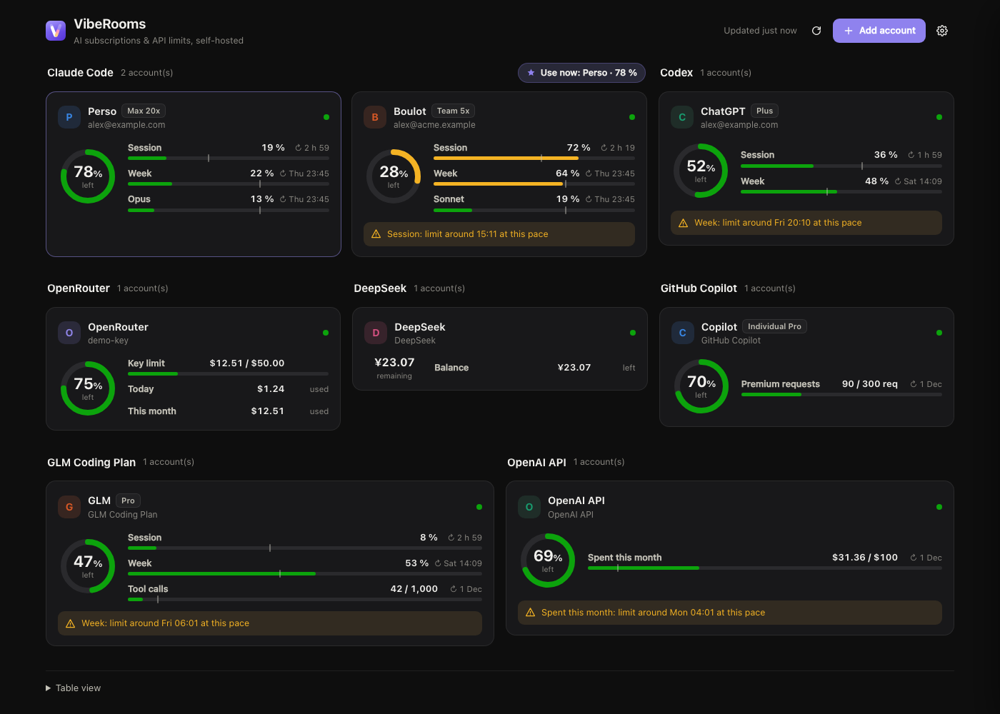
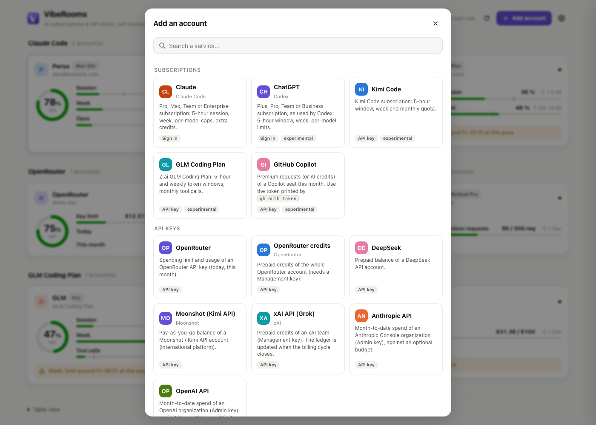

# VibeRooms

**How much room is left on your AI subscriptions?** VibeRooms is a small self-hosted service that tracks the usage
limits of your AI subscriptions and API keys (Claude, ChatGPT, GitHub Copilot, OpenRouter, DeepSeek, OpenAI and
Anthropic APIs…, several accounts each): headroom before the next limit, when it resets, whether you will hit it at
the current pace, and which account to use right now. Anything else that exposes its quota over HTTP can be added
from the dashboard, without code.

[Français](README.fr.md)



- **Dashboard**: per account, the headroom before the next limit, the 5-hour session, the week, per-model caps,
  extra-usage credits, a pace marker and a projection ("limit around 19:10 at this pace"), plus history charts.
- **"Use now"**: per tool (Claude Code, Codex), the account with the most headroom.
- **macOS menu bar app**: one gauge per account, native menu, notifications at 80 % / 95 % / reset.
- **Claude Code status line**: `Personal 20% ↻1h22 · wk 4% │ Work 31% left`.
- **[Homepage](https://gethomepage.dev) integration**: a group of widgets, kept in sync automatically.
- **Self-hosted**: one Rust binary (≈7 MB) with SQLite. Run it on your own computer, or on an always-on home server
  reached over Tailscale to follow it from every device. No cloud, no telemetry.
- **English / French** user interface.

> [!WARNING]
> **Unofficial.** VibeRooms is not affiliated with Anthropic, OpenAI or Google. Subscription limits are not exposed by
> public APIs: VibeRooms signs in with the OAuth clients of the official CLIs (Claude Code, Codex) and reads the
> internal endpoints those tools use. They can change or break at any time, and using them may not be covered by the
> providers' terms. VibeRooms only **reads** your profile and usage (it never sends prompts). Use it at your own risk,
> and read your providers' terms first.

## Supported providers

| Service | What is tracked | How | Status |
|---|---|---|---|
| Claude (Pro, Max, Team, Enterprise) | 5-hour session, week, per-model weekly caps, extra credits | Sign in (OAuth, `user:profile` scope) | Stable |
| ChatGPT (Plus, Pro, Team…), as used by Codex | 5-hour window, week, per-model limits | Sign in (OAuth) | Experimental |
| GitHub Copilot | Premium requests or AI credits this month | `gh auth token` | Experimental (internal endpoint) |
| Kimi Code | 5-hour window, week, monthly quota | Kimi Code key | Experimental (internal endpoint) |
| GLM Coding Plan (Z.ai) | 5-hour and weekly token windows, monthly tool calls | Coding Plan key | Experimental (internal endpoint) |
| OpenRouter | Key spending limit, today, this month; account credits | API key / Management key | Documented API |
| DeepSeek | Prepaid balance | API key | Documented API |
| Moonshot (Kimi API) | Pay-as-you-go balance | API key | Documented API |
| xAI API (Grok) | Prepaid credits of a team | Management key + team ID | Documented API (ledger updated at cycle close) |
| Anthropic API | Month-to-date spend, against an optional budget | Admin key | Documented API |
| OpenAI API | Month-to-date spend, against the org spend limit | Admin key | Documented API |
| **Anything else** | Remaining / used / limit / % / reset read from any JSON endpoint | [Custom connector](#custom-connectors) | — |

Not possible today: **Google AI Pro/Ultra** (Google moved individual plans to the closed-source Antigravity CLI,
whose quota API is locked to its client) and **SuperGrok / Mistral Le Chat** (no API). **Gemini API (AI Studio)**
quotas are readable through Cloud Monitoring with a service account: planned.

## How it works

```
 your laptop(s)                         home server (Mac mini, NAS, Pi…)
 ┌───────────────────────┐   Tailscale  ┌──────────────────────────────┐        ┌──────────────────┐
 │ browser: dashboard    │ ───────────► │ viberooms (Rust, SQLite)     │ ─────► │ provider usage   │
 │ menu bar app (macOS)  │ ◄─ JSON ──── │  • one OAuth session/account │  every │ endpoints        │
 │ Claude Code status    │              │  • history, pace, projection │  3 min │ (read-only)      │
 └───────────────────────┘              │  • Homepage widgets          │        └──────────────────┘
                                        └──────────────────────────────┘
```

Everything can also run on a single machine: the server and the menu bar app both default to `127.0.0.1:8790`. A
separate, always-on server keeps the history complete while your laptop sleeps, and lets every device see the same data.

Each account is connected **from the dashboard** with its own OAuth session (PKCE), requesting the narrowest scope
available (`user:profile` for Claude). VibeRooms **never reuses the tokens of your CLIs**: refresh tokens rotate, and
sharing them would log your Claude Code or Codex out. Tokens are stored on the server in `accounts.json` (mode
`0600`) and are never sent to the browser or to the menu bar app.

## Install the server

**From source** (Rust 1.80+):

```sh
git clone https://github.com/mifefr/viberooms && cd viberooms
cargo build --release -p viberooms
./target/release/viberooms
```

Then open `http://localhost:8790` and click **Add account**. To reach it from your other devices, also listen on a
private address: `VR_HOST=127.0.0.1,100.64.0.10` (localhost + your Tailscale address).

- **macOS (launchd)**: `VR_HOST=127.0.0.1,100.64.0.10 ./deploy/macos/install-server.sh`. Every `VR_*` variable you set is
  saved into the agent.
- **Linux (systemd)**: see [`deploy/linux/viberooms.service`](deploy/linux/viberooms.service).
- **Docker**: `docker build -t viberooms . && docker run -d -p 127.0.0.1:8790:8790 -v viberooms:/data viberooms`.

### Configuration

| Variable | Default | Description |
|---|---|---|
| `VR_HOST` | `127.0.0.1` | Comma-separated addresses to listen on. Prefer localhost + a Tailscale/VPN address over `0.0.0.0`. |
| `VR_PORT` | `8790` | Port. |
| `VR_PUBLIC_URL` | `http://<first host>:<port>` | URL used in links and Homepage widgets. |
| `VR_DATA_DIR` | `~/.config/viberooms` | Accounts (`accounts.json`) and history (`history.sqlite`, 45 days). |
| `VR_LANG` | system | `en` or `fr` for server-side strings (Homepage widgets). The page follows the browser. |
| `VR_POLL_MS` | `180000` | Collection interval per account. Keep it reasonable. |
| `VR_HOMEPAGE_DIR` | — | Homepage config directory; enables the integration. |
| `VR_HOMEPAGE_GROUP` | `AI` | Name of the generated Homepage group. |
| `VR_HOMEPAGE_AFTER` | — | Existing group after which the new group is placed in the layout. |
| `VR_HOMEPAGE_URL` | `http://127.0.0.1:3000` | Homepage base URL, used to trigger a refresh of its page. |
| `VR_HOOK` | — | Shell command run whenever the list of accounts changes. |
| `VR_LOG` | `info` | Log level (`debug`, `info`, `warn`). |

## Connect accounts



**Subscriptions (sign in)**

1. **Add account**, pick the service, give it a name.
2. **Open the authorization page**. Sign in **with the right account**: for another account than the one in your
   browser, use a private window.
3. Paste what the provider gives you back:
   - Claude shows a code (`xxxx#yyyy`);
   - ChatGPT redirects to a `http://localhost:1455/…` page that fails to load. Copy that full address.

   The dialog submits as soon as what you paste looks right.

**API keys**: paste the key (and the extra fields some services need, such as a team ID or a monthly budget), then
**Check and add**. Each card in the dialog links to the page where the key is created.

When a session expires (roughly 4 weeks without use), the card says **Sign-in required**: reconnect it from its
details panel. API keys are checked with a read-only call before they are saved.

Deep links: `/#account/<id>` opens an account, `/#add` or `/#add/<service>` the add dialog.

## Menu bar app (macOS)

```sh
./deploy/macos/bundle-bar.sh && cp -R dist/VibeRooms.app ~/Applications/ && open ~/Applications/VibeRooms.app
```

Configuration lives in `~/Library/Application Support/VibeRooms/config.json`:

```json
{ "server": "http://100.64.0.10:8790", "notifications": true, "lang": "auto", "switcher": false }
```

The menu shows one line per account, grouped by tool, with a coloured level (🟢 🟡 🔴) and the headroom left; the
details (every limit, reset time, extra credits) are in its submenu, along with a link to the account in the
dashboard. The top line says which account to use now for each tool. **Settings** holds notifications, **Open at
login** and account switching. The menu bar icon draws up to five gauges, Claude accounts first.

### Claude Code status line

In `~/.claude/settings.json`:

```json
"statusLine": {
  "type": "command",
  "command": "'/Users/you/Applications/VibeRooms.app/Contents/MacOS/viberooms-bar' --statusline",
  "refreshInterval": 30
}
```

It reads a local cache written by the menu bar app, so it costs no network call (≈15 ms). Already have a status
line? Add `--wrap '<your command>'` and both are shown side by side.

### Account switching for Claude Code (experimental, off by default)

With `"switcher": true`, the menu can switch the Claude account that Claude Code uses **on this Mac**. It swaps only
`claudeAiOauth` in the `Claude Code-credentials` keychain item, keeping your MCP tokens, and `oauthAccount` in
`~/.claude.json`. Accounts are added through `claude auth login` in a separate config directory, so your current
session is never touched, and kept in the keychain (`VibeRooms account` items).

Caveats:
- Claude sessions already open keep the previous account until their token renews: restart them.
- This touches Claude Code's private storage format, which can change.
- Make sure switching accounts is compatible with your plan's terms.

## Custom connectors

**Add account → Custom connector** describes one HTTP call. Click *Call the endpoint*: the dashboard lists every
numeric value found in the answer and you pick their role (remaining, used, limit, % used, % remaining, reset date).
The description behind it is plain JSON, editable under *Advanced*:

```json
{
  "name": "My provider",
  "url": "https://api.example.com/v1/credits",
  "headers": { "Authorization": "Bearer {{key}}" },
  "limits": [
    { "key": "credits", "label": "Credits", "kind": "balance",
      "used": "/data/used", "limit": "/data/total", "unit": "USD" }
  ]
}
```

- **Paths** are JSON pointers. `*` matches every item (`/data/*/amount`, summed), `[type=X,unit=3]` keeps the array
  items whose fields match, numbers given as strings are accepted.
- **Limit fields**: `used`, `limit`, `remaining`, `percent`, `percentRemaining` (any two are enough), `resetsAt`
  (RFC 3339, `YYYY-MM-DD` or unix time) or `reset: "monthly" | "daily"`, `kind` (`session`, `day`, `week`, `month`,
  `balance`), `unit` or `unitPath`, `scale` / `usedScale` / `limitScale` / `remainingScale` (e.g. `0.01` for cents),
  `limitValue` (a template such as `{{field.budget}}`), `skipIf` (hide when a flag is true), `windowMs`.
- **Several calls**: `"requests": [{ "id": "costs", "url": "…" }, { "id": "limit", "url": "…", "optional": true }]`,
  then paths start with the id (`/costs/data/*/results/*/amount`).
- **Templates** in URLs, headers and bodies: `{{key}}`, `{{field.<id>}}`, `{{now}}`, `{{now_unix}}`, `{{today}}`,
  `{{month_start}}`, `{{month_start_unix}}` (UTC).

The built-in services are written the same way in
[`server/src/providers/presets.json`](server/src/providers/presets.json): adding one is a pull request with a JSON
entry and a test using a sample answer. Try yours without rebuilding: `VR_PRESETS_FILE=my-presets.json viberooms`.

## Homepage

Set `VR_HOMEPAGE_DIR` (and optionally `VR_HOMEPAGE_GROUP` / `VR_HOMEPAGE_AFTER`). VibeRooms then writes a generated
block between markers in `services.yaml`, registers the group in `settings.yaml` (with a one-time backup of both
files), and asks Homepage to regenerate its page. The widgets use `GET /api/homepage` and `GET /api/homepage/{id}`.

## Security

- Listen on localhost and a private address (Tailscale) only. There is no login on the dashboard: anyone who can
  reach it can see the usage and add or remove accounts.
- Mutating API calls require an `X-VibeRooms: 1` header, which a third-party website cannot send without a refused
  CORS preflight.
- Tokens: `accounts.json` with mode `0600` in a `0700` directory. They are never returned by the API.

## Development

```sh
cargo test --workspace                  # unit tests
cargo build --release -p viberooms && ./deploy/integration-test.sh   # end to end, against mock providers
python3 deploy/mock_server.py 8794      # mock Anthropic + OpenAI (tokens last 90 s, rotating refresh tokens)
VR_WEB_DIR=server/web ./target/release/viberooms   # serve the page from disk while editing it
```

Adding a provider means writing a connector in `server/src/providers/` (sign-in, refresh, fetch, normalise into
`Snapshot`) and registering it in `providers/mod.rs`. Everything else is provider-agnostic.

## License

[MIT](LICENSE)
